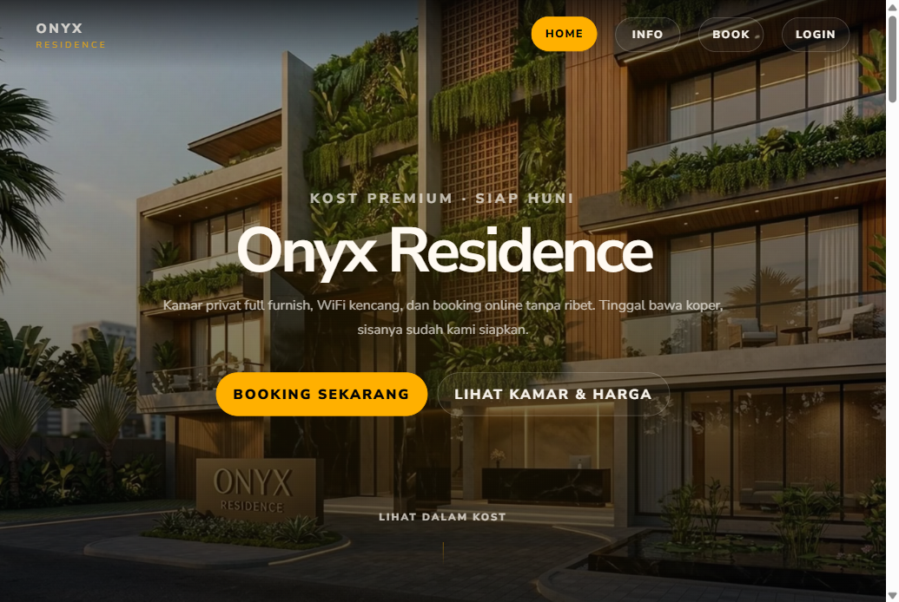

# Onyx Residence — Online Booking Engine & Kost Management System

🌐 **Live Demo**: [https://onyx.nawf.dev](https://onyx.nawf.dev)

Aplikasi fullstack manajemen hunian/kost dengan sistem booking online, portal penghuni, dashboard admin, integrasi payment gateway, dan monitoring kamar berbasis IoT.

## Fitur

### Landing Page
- Hero section dengan animasi **image sequence** (3 set sequence: facade, interior, courtyard)
- Preloader progress bar saat memuat aset sequence
- Info halaman dengan detail fasilitas, harga kamar, dan galeri
- Booking/registrasi form dengan kalkulasi sewa otomatis

### Portal Penghuni
- Login via email/WhatsApp + password
- Dashboard tagihan (sewa, deposit, utilitas)
- Pembayaran QRIS (via BAYAR GG) & transfer manual + upload bukti
- Riwayat meter listrik & air
- **Smart Access** — kontrol kunci pintu, QR visitor pass
- **Smart Room** — kontrol lampu, AC/kipas, suhu, water heater
- Tiket layanan / komplain
- Invoice & print billing

### Admin Dashboard
- Overview operasional (occupancy, penghuni, pendapatan)
- Manajemen kamar (CRUD, filter status, detail kamar)
- Data penghuni (long stay & short stay)
- Verifikasi pembayaran (approve/reject bukti transfer)
- Pencatatan meter utilitas listrik & air
- Tiket layanan penghuni
- Laporan arus kas (cashflow) dengan print
- Chat penghuni

### Integrasi
- **BAYAR GG** payment gateway (QRIS/payment link)
- **Wokwi ESP32** — IoT telemetry monitoring kamar
- **Cloudflare R2** — hosting image sequence assets

## Tech Stack

| Layer | Teknologi |
|---|---|
| **Frontend** | Vite + Vanilla JavaScript (SPA) |
| **Backend** | PHP native (API) |
| **Database** | MySQL via PDO |
| **Payment** | BAYAR GG API |
| **IoT** | Wokwi ESP32 simulator |
| **Storage** | Cloudflare R2 / CDN |
| **Deploy** | Apache / XAMPP |

## Struktur Project

```text
PPL_UAS/
├── fe/                          # Frontend Vite + JavaScript
│   ├── src/
│   │   ├── main.js              # State, routing, render, event binding (3785 baris)
│   │   ├── styles.css           # Seluruh styling aplikasi
│   │   ├── data.js              # Seed data kamar awal
│   │   └── utils.js             # Helper rupiah, escapeHtml, slug
│   ├── public/                  # Image sequence frames & aset statis
│   ├── index.html               # Entry point SPA
│   └── vite.config.js           # Vite config (base: './')
│
├── be/                          # Backend PHP API
│   ├── api/                     # Endpoint REST
│   │   ├── health.php           # Health check
│   │   ├── kamar.php            # CRUD kamar
│   │   ├── tamu.php             # Data tamu
│   │   ├── reservasi.php        # Reservasi
│   │   ├── resident-application.php  # Aplikasi penghuni
│   │   ├── payment-check.php    # Cek status bayar
│   │   ├── payment-create.php   # Create payment link
│   │   ├── payment-proof.php    # Upload & review bukti bayar
│   │   ├── payment-webhook.php  # Webhook BAYAR GG
│   │   ├── auth-logout.php      # Logout
│   │   ├── auth-resident.php    # Auth resident
│   │   ├── admin-auth.php       # Auth admin
│   │   ├── admin-state.php      # State admin (sync data)
│   │   ├── access.php           # Smart access door lock
│   │   ├── chat.php             # Chat penghuni-admin
│   │   ├── iot-ingest.php       # Telemetry IoT ESP32
│   │   ├── service-ticket.php   # Tiket layanan
│   │   ├── utility-meter.php    # Meter listrik & air
│   │   ├── fixture.php          # Data fixture/testing
│   │   └── test-fixture.php     # Test fixtures
│   ├── config/
│   │   ├── cors.php             # CORS headers
│   │   ├── database.php         # Koneksi MySQL via PDO
│   │   └── bayar.php            # Konfigurasi BAYAR GG
│   ├── lib/
│   │   ├── Database.php         # PDO singleton
│   │   ├── Response.php         # JSON response helper
│   │   ├── Request.php          # Request parser
│   │   ├── Auth.php             # Authentication helper
│   │   ├── BayarGG.php          # BAYAR GG API wrapper
│   │   ├── JsonStore.php        # JSON file storage
│   │   ├── ApplicationMapper.php # Data mapper aplikasi
│   │   └── RateLimit.php        # Rate limiter
│   ├── storage/                 # Runtime data (uploads, JSON)
│   └── kostku.sql               # Skema database
│
├── docs/
│   ├── PRD_ONYX_RESIDENCE_FULLSTACK.md
│   ├── Onyx_Project_Presentation.pdf
│   ├── Onyx_Project_Presentation.html
│   ├── onyx-api-openapi.yaml
│   ├── DEPLOY_ONYX.md
│   ├── ONYX_API_TESTING_GUIDE.md
│   └── portal-roadmap.md
│
├── LICENSE                      # MIT License
└── README.md                    # File ini
```

## Screenshots

| Halaman | Tampilan |
|---|---|---|
| **Public Landing Page** |  |

## Setup & Development

### Prasyarat
- Node.js 18+
- PHP 8.1+
- MySQL / MariaDB
- XAMPP / Laragon (opsional)

### 1. Clone & Install Frontend

```bash
cd fe
npm install
npm run dev
```

Akses di `http://127.0.0.1:5173/`

### 2. Setup Database

```bash
# Import schema ke MySQL
mysql -u root -p < be/kostku.sql
```

Sesuaikan koneksi di `be/config/database.php` jika perlu.

### 3. Jalankan Backend

Backend PHP bisa dijalankan via:

```bash
# Built-in PHP server
php -S 127.0.0.1:80 -t .
```

Atau deploy di XAMPP (`C:\xampp\htdocs\PPL_UAS`).

### 4. Build Frontend untuk Production

```bash
cd fe
npm run build
```

Hasil build di `fe/dist/`.

## Development Mode

Saat `npm run dev` (Vite), frontend otomatis mengarahkan API ke `http://localhost/PPL_UAS/be/api/`. Pastikan backend PHP berjalan di port 80.

## Environment Variables

Buat `fe/.env` untuk override:

```env
VITE_ONYX_SEQUENCE_ASSET_BASE_URL=https://your-cdn.example/onyx-sequences
```

## API Endpoints

| Method | Endpoint | Fungsi |
|---|---|---|
| GET | `/be/api/health.php` | Health check |
| GET/POST | `/be/api/kamar.php` | CRUD kamar |
| GET/POST | `/be/api/tamu.php` | Data tamu |
| GET/POST | `/be/api/reservasi.php` | Reservasi |
| GET/POST | `/be/api/resident-application.php` | Aplikasi penghuni |
| GET/POST | `/be/api/payment-proof.php` | Upload & review bukti bayar |
| POST | `/be/api/payment-check.php` | Cek status pembayaran |
| POST | `/be/api/payment-create.php` | Buat payment link QRIS |
| POST | `/be/api/payment-webhook.php` | Webhook BAYAR GG |
| POST | `/be/api/auth-resident.php` | Login penghuni |
| POST | `/be/api/admin-auth.php` | Login admin |
| POST | `/be/api/auth-logout.php` | Logout |
| GET/POST | `/be/api/access.php` | Smart access door lock |
| GET/POST | `/be/api/iot-ingest.php` | Telemetry IoT ESP32 |
| GET/POST | `/be/api/utility-meter.php` | Meter listrik & air |
| GET/POST | `/be/api/service-ticket.php` | Tiket layanan |
| GET/POST | `/be/api/chat.php` | Chat penghuni-admin |
| GET | `/be/api/admin-state.php` | Sync state admin |

## Lisensi

**MIT License** — lihat file [LICENSE](./LICENSE).
